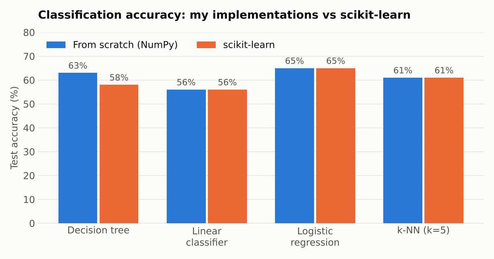
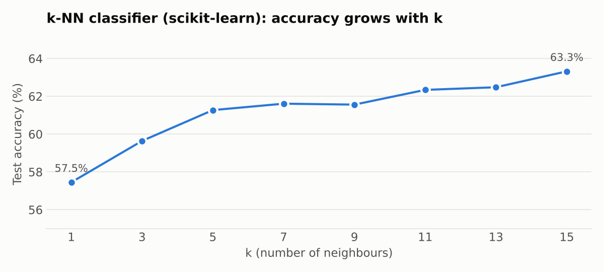

# Online News Popularity: ML Algorithms from Scratch

This project predicts how popular a Mashable article will be.
The main classic machine-learning algorithms are **implemented from scratch in NumPy**, and each one is benchmarked against its scikit-learn counterpart.
The point was to understand how each algorithm works inside, not just to call a library.

> **Course homework** — Sapienza University of Rome · my first hands-on machine learning project  
> **Author:** Francesco Fabrizi

---

## Dataset

[Online News Popularity](https://archive.ics.uci.edu/dataset/332/online+news+popularity) (UCI) contains 39,644 Mashable articles with 58 predictive features.
The features include word counts, number of images and videos, keywords, publication day, topic channel and sentiment/polarity scores.
The target is the number of social-media shares.

Two tasks are defined on this dataset:

- **Regression:** predict the number of shares. The metric is RMSE.
- **Classification:** predict whether an article is popular (≥ 1,400 shares) or not (< 1,400). The metric is accuracy.

Data is split 80/20 into train and test sets. Features are standardised, which also prevents overflow in the sigmoid-based models.

---

## Implemented models

| Model | Task | From scratch | scikit-learn |
|-------|------|--------------|--------------|
| Decision tree (entropy / information gain) | Classification | 63% | 58% |
| Linear classifier (perceptron-style) | Classification | 56% | 56% |
| Logistic regression (gradient descent, BCE loss) | Classification | 65% | 65% |
| k-Nearest Neighbors (k = 5) | Classification | 61% | 61% |
| Neural network (1 hidden layer, ReLU + sigmoid) | Classification | 52–65%* | 66% |
| Linear regression, no regularisation | Regression | RMSE 7,664 | RMSE 7,644 |
| Linear regression + L1 / L2 / Elastic Net | Regression | RMSE ≈ 7,644–7,662 | RMSE ≈ 7,644 |
| k-Nearest Neighbors (k = 5) | Regression | RMSE 8,864 | RMSE 8,864 |
| Neural network (1 hidden layer, ReLU) | Regression | RMSE 0.67† | RMSE 0.66† |

\* The from-scratch network is sensitive to the train/test split and to weight initialisation. 
† Computed on standardised targets, so it is not comparable with the other RMSE values.

For k-NN, the test accuracy of the scikit-learn classifier keeps rising as k grows:

---

## Takeaways

- Logistic regression was the most accurate and stable classifier. k-NN gives similar results but is much slower at prediction time. With scikit-learn, accuracy keeps improving up to k = 15 (63%).
- Regularisation hardly changes linear regression here. The share distribution is very heavy-tailed, and that dominates the error.
- Writing backpropagation by hand made it clear why feature and target scaling matter. Before normalising y, the regression network needed tiny learning rates to avoid overflow.

---

## Repository contents

| File | Description |
|------|-------------|
| `Online_news_popularity.ipynb` | Notebook with code, explanations (Italian) and outputs |
| `Online_news_popularity.py` | Same code exported as a Python script |

---

## Running it

The notebook downloads the dataset from UCI by itself and runs on Google Colab without any setup:

**[Open in Colab](https://colab.research.google.com/drive/1xe_RlVNXkAbRpa8jtHLSUyshC9kMZWb5?usp=sharing)**
